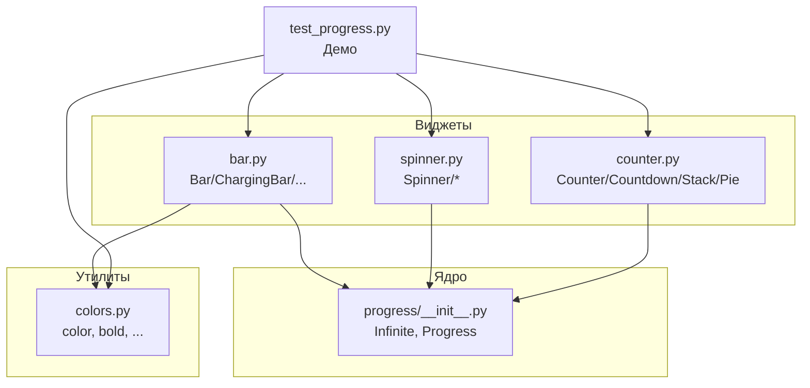
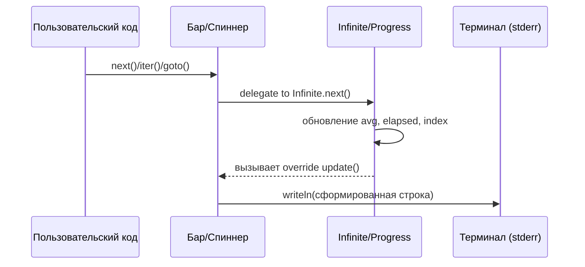

# progress — прогресс-бары и спиннеры для python


## Быстрый старт

- **Установка**:
```bash
pip install progress
```
- **Простой прогресс-бар**:
```python
from progress.bar import Bar

bar = Bar('Processing', max=20)
for i in range(20):
    # выполняем работу
    bar.next()
bar.finish()
```
- **Контекстный менеджер**:
```python
from progress.bar import Bar

with Bar('Processing', max=20) as bar:
    for i in range(20):
        bar.next()
```
- **Спиннер** (неизвестное число шагов):
```python
from progress.spinner import Spinner

spinner = Spinner('Loading ')
while state != 'FINISHED':
    # выполняем работу
    spinner.next()
```

---

## 1. Структура проекта

```text
progress-master/
├─ demo.gif
├─ README.md
├─ progress/
│  ├─ __init__.py
│  ├─ bar.py
│  ├─ counter.py
│  ├─ colors.py
│  └─ spinner.py
└─ test_progress.py
```

## 2. Описание файлов

### `progress/__init__.py`
- **Назначение**: Базовые классы и инфраструктура отображения: `Infinite` (бесконечный индикатор) и `Progress` (индикатор с известным максимумом). Управление временем, расчёт средних, ETA, вывод в TTY, скрытие/показ курсора.
- **Ключевые классы/функции**:
  - `Infinite`: счётчик шагов, подсчёт среднего времени шага (SMA), вывод через `writeln`, метод `next`, контекст-менеджер, поддержка шаблонов через `message % self` и `__getitem__`.
  - `Progress(Infinite)`: добавляет `max`, `progress`, `percent`, `remaining`, `eta`, `goto`, `iter` с попыткой определить длину итератора.
- **Связи**: Используется классами из `bar.py`, `spinner.py`, `counter.py` как базовый слой. Пишет в `stderr`, опционально скрывает курсор ANSI-последовательностью.
- **Краткая логика**: `next()` обновляет индекс и скользящее среднее времени шага на окне `sma_window`, рассчитывает производные метрики и вызывает переопределяемый `update()` для визуализации.

### `progress/bar.py`
- **Назначение**: Реализация прогресс-баров с заполнением и вариантами отрисовки.
- **Ключевые классы/функции**:
  - `Bar(Progress)`: базовый бар; параметры: `width`, `fill`, `empty_fill`, `suffix`, префиксы/суффиксы бара; поддерживает цвет через `colors.color`.
  - `ChargingBar(Bar)`: сплошное заполнение `█`, точечный фон, суффикс в процентах.
  - `FillingSquaresBar(ChargingBar)`, `FillingCirclesBar(ChargingBar)`: альтернативные символы заполнения/фона.
  - `IncrementalBar(Bar)`: «фазовый» бар с частично заполненными символами; на Windows — укороченный набор фаз.
  - `PixelBar(IncrementalBar)`, `ShadyBar(IncrementalBar)`: иные наборы фаз.
- **Связи**: Наследуется от `Progress` из `__init__.py`; использует `colors.color` из `colors.py`.
- **Краткая логика**: В `update()` вычисляется число заполненных/пустых клеток по `progress`, формируется строка с `message` и `suffix` через шаблоны.

### `progress/spinner.py`
- **Назначение**: Набор спиннеров для неограниченного числа шагов.
- **Ключевые классы/функции**:
  - `Spinner(Infinite)`: базовый спиннер, циклически выводит символы из `phases`.
  - `PieSpinner`, `MoonSpinner`, `LineSpinner`, `PixelSpinner`: преднастроенные фазы символов.
- **Связи**: Наследуется от `Infinite` из `__init__.py`.
- **Краткая логика**: Индекс шага `index % len(phases)` выбирает текущий символ, вывод через `writeln`.

### `progress/counter.py`
- **Назначение**: Минималистичные счётчики/индикаторы.
- **Ключевые классы/функции**:
  - `Counter(Infinite)`: печатает текущее `index` рядом с `message`.
  - `Countdown(Progress)`: печатает `remaining`.
  - `Stack(Progress)`/`Pie(Stack)`: ступенчатые/пирожковые символы по прогрессу.
- **Связи**: Наследуются от `Infinite`/`Progress`.
- **Краткая логика**: `update()` формирует простую односимвольную/числовую индикацию.

### `progress/colors.py`
- **Назначение**: Утилиты раскраски строк ANSI SGR (цвета/стили, включая 256-цветные).
- **Ключевые функции**: `color(s, fg=None, bg=None, style=None)` и частичные обёртки `red`, `bold`, и т.д.
- **Связи**: Используется `Bar` (опциональная окраска заполненной части).
- **Краткая логика**: Строит SGR-последовательность по параметрам, валидирует значения, оборачивает строку.

### `test_progress.py`
- **Назначение**: Демонстрационный скрипт, запускающий разные бары и спиннеры, показывающий API.
- **Ключевые сущности**: Импортирует бары/спиннеры/счётчики, «прогоняет» их с разными `suffix`, `iter`, `with`-контекстом, цветом.
- **Связи**: Использует все основные модули пакета.
- **Краткая логика**: Симулирует работу с `sleep()` и выводит серию прогрессов.

## 3. Архитектура проекта

### Общая структура
- **Слой ядра**: `Infinite` и `Progress` — управление временем, индексом, расчёт метрик и унифицированный вывод в терминал.
- **Слой визуализаций**: конкретные реализации прогресс-баров (`bar.py`), спиннеров (`spinner.py`) и счётчиков (`counter.py`).
- **Сервисный слой**: раскраска `colors.py`.

### Потоки данных
1. Пользователь вызывает методы `next()`/`iter()` или `goto()` на экземпляре бара/спиннера.
2. `Infinite.next()` обновляет индекс, измеряет дельту времени, пересчитывает среднее время шага и производные метрики.
3. Вызывается переопределённый `update()` конкретного виджета, который формирует итоговую строку.
4. `writeln()` перерисовывает строку в TTY, обновляет максимальную ширину, управляет курсором.

### mermaid-схема модулей


### mermaid-схема жизненного цикла вызова


## 4. Библиотеки/фреймворки
- **Стандартная библиотека**: `collections.deque`, `datetime.timedelta`, `math.ceil`, `sys.stderr`, `time.monotonic|time`, `random`, `time` — расчёты времени, вывод и демо-паузы.
- **Внешние зависимости**: отсутствуют (кроме установки через PyPI самой библиотеки `progress`).

Где используются:
- В `__init__.py` — время, stderr, структуры данных.
- В `test_progress.py` — `random`, `time` для имитации нагрузки.

## 5. Точка входа и запуск
- **Как запускается**: Это библиотека для импорта. Использование — через `import` из пользовательского кода. Демо можно запустить командой:
```bash
python test_progress.py
```
- **Что выполняется первым**: При создании экземпляра бара/спиннера и входе в контекст — инициализация `Infinite/Progress`, возможное скрытие курсора, начальный `writeln('')`.

## 6. Архитектурные особенности
- **TTY-aware вывод**: Проверка `isatty()` (можно отключить `check_tty=False`). Без TTY — молчаливое отсутствие вывода.
- **Безопасный таймер**: Использование `time.monotonic()` с откатом на `time.time()` — корректные оценки интервалов.
- **Скользящее среднее**: SMA по окну `sma_window` для стабильных оценок `avg` и `eta`.
- **Шаблонизация строки**: Подстановка через `message`/`suffix` с доступом к атрибутам (`%(percent)d`, `%(elapsed_td)s`, и т.п.).
- **Поддержка Windows**: Упрощённый набор «фаз» в `IncrementalBar` для совместимости шрифтов/консолей.
- **Цвета ANSI**: Вынесены в `colors.py`; поддержка 8/256-цветов и стилей.

## 7. Прогресс-бары (Bars) — справка по API

Доступно 7 типов:
- `Bar`
- `ChargingBar`
- `FillingSquaresBar`
- `FillingCirclesBar`
- `IncrementalBar`
- `PixelBar`
- `ShadyBar`

Использование цикла:
```python
from progress.bar import Bar

bar = Bar('Processing', max=20)
for i in range(20):
    # Выполняем работу
    bar.next()
bar.finish()
```

Контекстный менеджер:
```python
from progress.bar import Bar

with Bar('Processing', max=20) as bar:
    for i in range(20):
        bar.next()
```

Результат:
```
Processing |#############                   | 42/100
```

Итерация по коллекции:
```python
for i in Bar('Processing').iter(it):
    # Выполняем работу
    pass
```

### ⚙️ Настройка прогресс-бара
```python
from progress.bar import Bar

bar = Bar('Loading', fill='@', suffix='%(percent)d%%')
```
Даёт, например:
```
Loading |@@@@@@@@@@@@@                   | 42%
```

### 📊 Доступные шаблонные переменные
Можно использовать в `message` и `suffix`:

| Имя | Значение |
| --- | --- |
| `index` | текущее значение |
| `max` | максимальное значение |
| `remaining` | оставшееся количество (`max - index`) |
| `progress` | доля выполнения (`index / max`) |
| `percent` | процент выполнения (`progress * 100`) |
| `avg` | среднее время шага (сек) |
| `elapsed` | прошедшее время (сек) |
| `elapsed_td` | прошедшее время как `timedelta` |
| `eta` | предполагаемое оставшееся время (`avg * remaining`) |
| `eta_td` | оставшееся время как `timedelta` |

### 🧩 Собственные классы прогресс-баров
```python
from progress.bar import Bar

class FancyBar(Bar):
    message = 'Loading'
    fill = '*'
    suffix = '%(percent).1f%% - %(eta)ds'

class SlowBar(Bar):
    suffix = '%(remaining_hours)d hours remaining'

    @property
    def remaining_hours(self):
        return self.eta // 3600
```

## 8. Спиннеры (Spinners)

Простой спиннер:
```python
from progress.spinner import Spinner

spinner = Spinner('Loading ')
while state != 'FINISHED':
    spinner.next()
```

Предустановленные спиннеры:
- `Spinner`
- `PieSpinner`
- `MoonSpinner`
- `LineSpinner`
- `PixelSpinner`

## 9. Примеры с цветом
```python
from progress.bar import IncrementalBar
from progress.colors import bold

bar = IncrementalBar(bold('Colored'), color='green')
for i in bar.iter(range(200)):
    # работа
    pass
```

Подпись относится к текущей версии проекта.

---

Автор: legenda  
Telegram: [@LEGENDA_SD](https://t.me/LEGENDA_SD)
